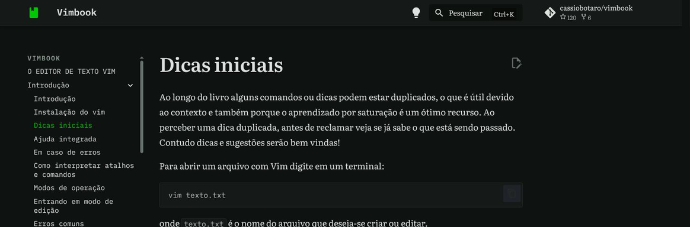

# Como contribuir

Primeiramente, muito obrigado pela disponibilidade em querer contribuir! 🫶

Estava lendo o repositório e teve uma nova ideia? Não entendeu alguma explicação, encontrou erros de grafia ou de código? Aqui você encontra um guia para você colaborar com a melhoria do material, independentemente do seu nível de conhecimento.

Entenda que não existem dúvidas simples demais e que toda contribuição é recebida com igual entusiasmo.

## Código de conduta

Trate todos igualmente com respeito e siga o nosso [código de conduta](CODE_OF_CONDUCT.md).

## Contribuições possíveis

Você pode ajudar o projeto das seguintes maneiras:

* Lendo o conteúdo e divulgando a seus conhecidos;
* Reportando erros de grafia encontrados no texto;
* Questionando explicações e solicitando uma melhoria no texto;
* Sugerindo melhorias do conteúdo;
* Adicionando novos materiais e tópicos.

## Sua primeira contribuição?

Caso queira apenas sugerir alguma modificação no conteúdo, vá em [issues](../../issues), certifique-se de que alguém já não tenha feito a sugestão que você pretendia e tente descrever com a maior riqueza de detalhes possível. Quando necessário, adicione imagens (principalmente quando for um erro).

Uma outra maneira de contribuir é editando você mesmo os arquivos através do GitHub.

O caminho mais curto começa no próprio livro: abra a página onde está o erro em <https://vimbook.com.br/> e clique no ícone de lápis "Editar esta página", no canto superior direito do texto.



Ele leva direto ao arquivo certo, já aberto no editor do GitHub. Vale começar por aí em vez de procurar o arquivo na pasta [`docs/`](docs): os nomes não seguem a ordem de leitura, que fica no `nav` do arquivo `zensical.toml`. Então a página que você viu em terceiro lugar no livro dificilmente será a terceira da listagem.

A partir daí o próprio GitHub conduz o resto:

1. faça a alteração no editor e desça até o fim da página;
2. descreva em uma linha o que mudou — é isso que vira o título da sua proposta;
3. escolha enviar a mudança em uma nova *branch*, e não direto na `main`;
4. confira o resumo das alterações e confirme a criação do *pull request*.

Se você não tem permissão de escrita no repositório, não precisa preparar nada antes: o GitHub cria uma cópia dele na sua conta e abre o *pull request* a partir dela.

Assim que a pessoa responsável analisar sua contribuição, suas alterações serão mescladas ao conteúdo.

🤖 Automaticamente, em poucos minutos uma nova versão do site já estará disponível!


## Desenvolvendo localmente

Crie um ambiente virtual utilizando o comando:

```bash
python -m venv .venv
```

Ative o ambiente através do comando:

```bash
source .venv/bin/activate
```

ou [equivalente em seu sistema operacional](https://cassiobotaro.dev/do_zero_a_implantacao/projeto/#o-ambiente-virtual).

Em seguida, instale as dependências necessárias:

```bash
python -m pip install -r requirements.txt
```

e para executar localmente:

```bash
zensical serve
```

O site fica disponível em <http://localhost:8000> e recarrega automaticamente a cada alteração.

## Convenções utilizadas e dicas

* Não utilize emojis de forma textual `:emoji:`, copie-os da [Emojipedia](https://emojipedia.org/pt);
* Todo título de seção é iniciado com um emoji;
* Novos capítulos devem ser adicionados também no menu de navegação (`nav`) que se encontra no arquivo `zensical.toml`;
* Páginas cujo título não começa com um cabeçalho `#` precisam declarar o título no *front matter*, por exemplo:

```yaml
---
title: Instalação do Vim
---
```

### Tabelas de comandos

Listas de referência — comando de um lado, descrição do outro — vão em
tabelas, não em blocos de código. Blocos de código são reservados para
comandos que a pessoa vai de fato digitar, porque só eles fazem sentido
com o botão de copiar:

```markdown
| Comando | Descrição |
|---------|-----------|
| `gg` | vai para o início do arquivo |
```

Dois detalhes que geram erro silencioso, porque o `zensical build`
aceita os dois casos sem reclamar:

* **Deixe uma linha em branco depois da tabela.** Sem ela, o parser
  continua lendo o parágrafo seguinte como linhas da tabela, e o texto
  aparece dentro dela, quebrado em uma célula por linha do arquivo.

* **Para exibir uma barra vertical dentro de uma célula, use
  `<code>&#124;</code>`.** O `\|` do GitHub não funciona aqui: o parser
  não é GFM e mostra a barra invertida na tela. Dentro de crases a
  entidade também não resolve, porque é escapada — só funciona com a
  tag `<code>` escrita à mão. Isso vale para comandos como `10|` (ir
  para a coluna 10); já o `\|` das expressões regulares do Vim, que é o
  operador de alternância, deve mesmo aparecer com a barra invertida.

### Teclas de atalho

Combinações com a tecla Control são escritas sempre do mesmo jeito, em
código, como `Ctrl-R`: a palavra `Ctrl`, um hífen e a tecla em
maiúscula. É a grafia da ajuda do próprio Vim (`:help CTRL-R`), o que
facilita encontrar o atalho por lá. As demais teclas seguem a mesma
ideia: `Alt-T`, `Ctrl-Alt-T`, `Ctrl-Insert`.

Quando um atalho é uma sequência, as teclas são separadas por espaço,
no mesmo trecho de código:

| Escreva | Em vez de |
|---------|-----------|
| `Ctrl-W f` | `Ctrl-wf`, `Ctrl-w-f` |
| `Ctrl-X Ctrl-L` | `Ctrl-x Ctrl-l`, `<Ctrl-x Ctrl-l>` |
| `Ctrl-R %` | `^r%`, `<C-R>%` |

Outras notações ficam restritas a onde fazem sentido:

* **`<C-r>`** só aparece dentro de mapeamentos e scripts, porque é a
  forma que o próprio `.vimrc` exige (`:help key-notation`);
* **`^M`, `^I`, `^[`** só aparecem para mostrar como o Vim *exibe* um
  caractere de controle na tela, nunca para indicar uma tecla a ser
  pressionada.

Um atalho não pode ir dentro de um bloco de código, porque o botão de
copiar levaria o texto `Ctrl-R`, e não a tecla. Quando um comando mistura
texto e atalhos, descreva os passos:

> Digite `:%s/`, pressione `Ctrl-R /` para inserir a última busca e
> complete com `/novo/g`.

### Blocos de código

Todo bloco de código declara a linguagem logo depois das crases, o que
liga o realce de sintaxe:

| Linguagem | Quando usar |
|-----------|-------------|
| `vim` | comandos de linha de comando (`:s`, `:g`, `:help`), trechos do `.vimrc` e scripts do Vim |
| `bash` | comandos digitados no terminal e scripts de shell |
| `c`, `python`, `latex`, `html`... | código de outras linguagens |
| `text` | texto de exemplo, saída de comandos, árvores de diretórios e sequências de teclas do modo normal |

Por exemplo:

````markdown
```vim
:%s/antigo/novo/g
```
````
